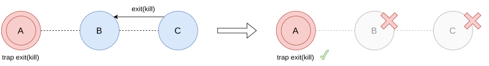

# Errori nella programmazione concorrente

In Erlang, di norma, i processi sono isolati: se uno muore, gli altri non se ne accorgono a meno che non siano "collegati".  
Quando due processi sono correlati, gli errori di uno devono poter influenzare l'altro. Per questo esistono:

- **link**: bidirezionali
- **monitor**: unidirezionali.

Il meccanismo con cui un processo "avvisa" gli altri della propria morte è l'**exit signal**.

## Gestione degli errori

### Link

- `link(Pid)` crea un collegamento tra il processo corrente e `Pid`.
- Il link definisce un percorso di propagazione degli errori tra i due processi.
- Se A è linkato a B e B muore, ad A viene mandato un exit signal. Vale anche il contrario: i link sono simmetrici.
- L'insieme dei processi linkati a un dato processo si chiama **link set**.
- Il segnale arriva (se A è un system process) come messaggio `{'EXIT', Pid, Why}`, dove `Pid` è il processo morto e `Why` il motivo.

### Exit signals

- Vengono generati da un processo quando muore.
- Sono mandati in broadcast a tutti i processi del link set del processo che muore.
- Contengono un argomento che spiega perché il processo è morto: lo si imposta con `exit(Reason)` oppure viene impostato implicitamente (per esempio `badarith`, `badarg`).
- Quando un processo termina "naturalmente" (finisce la sua funzione) il motivo è `normal`.
- Si possono mandare segnali esplicitamente con `exit(Pid, X)`: il mittente **non** muore (è una "fake death", il segnale è solo inviato a `Pid`).

### I processi

- Un **Non System Process** (processo normale) che riceve un exit signal muore anch'esso, a meno che il motivo sia `normal`.
- Un **System Process** riceve il segnale come un normale messaggio nella mailbox, quindi lo può gestire.
    
    `process_flag(trap_exit, true)` trasforma un processo in system process.

### Comportamento del ricevente
Il ricevente, a seconda del suo tipo di processo e dal segnale di exit che riceve, ha un coportamento diverso:

- System Process: `trap_exit = true`

    |Exit Signal| Azione|
    |---|---|
    |`kill`| il processo muore e manda in broadcast `killed` al suo link set.|
    | `X` | Viene aggiunto `{'EXIT', Pid, X}` alla mailbox. |

- Non System Process: `trap_exit = false`

    |Exit Signal| Azione|
    |---|---|
    |`normal`| il processo continua e il segnale svanisce.|
    | `kill` | il processo muore e manda in broadcast il segnale **senza modificarlo** al suo link set.|
    | `X` | il processo muore e manda in broadcast il segnale **senza modificarlo** al suo link set. |
    



In questo esempio solo `A` è un System Process.  
`kill` è intrappolabile **solo** dal processo a cui viene mandato (cioè `C`, che ne è destinatario diretto) e lo uccide comunque.

### Come scelgo di creare un processo?
- Non mi interessa se il processo che creo crasha:

    ```erlang
    Pid = spawn(fun() -> ... end).
    ```

- Voglio morire anch'io se il processo che creo crasha:

    ```erlang
    Pid = spawn_link(fun() -> ... end).
    ```

- Voglio gestire l'errore se il processo che creo crasha:

    ```erlang
    process_flag(trap_exit, true),
    Pid = spawn_link(fun() -> ... end).
    ```


## Monitor: link unidirezionali
I link sono simmetrici: se A muore, B riceve un exit signal e viceversa.   
Per evitare che un processo muoia bisogna renderlo system process, cosa non sempre desiderabile.

Il **monitor** è un link **asimmetrico**.

- Se A monitora B e B muore, ad A viene mandato un segnale.
- Se A muore, a B non viene mandato nulla.

Creazione di un monitor che monitora `B`:

```erlang
erlang:monitor(process, B)
```

- Se B muore con motivo `Reason`, ad A arriva il messaggio:

  ```erlang
  {'DOWN', Ref, process, B, Reason}
  ```
  dove `Ref` è il riferimento al monitor.  
  Si possono avere monitor multipli sullo stesso processo, ciascuno con il suo `Ref`.

Il monitor è unidirezionale: ripetere la chiamata crea più monitor indipendenti, e ognuno manda un messaggio `'DOWN'` quando B termina.