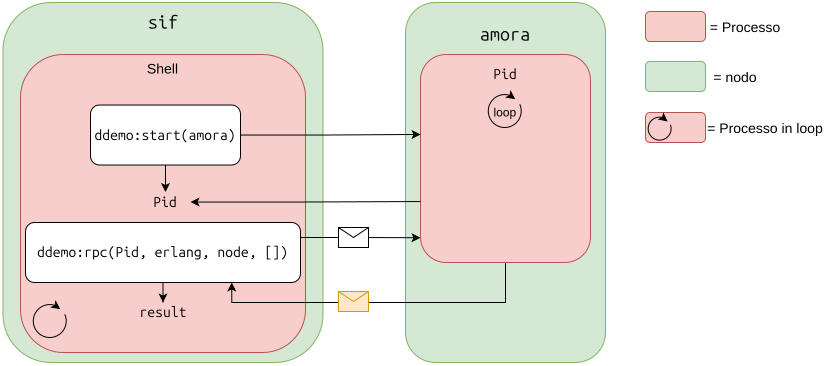
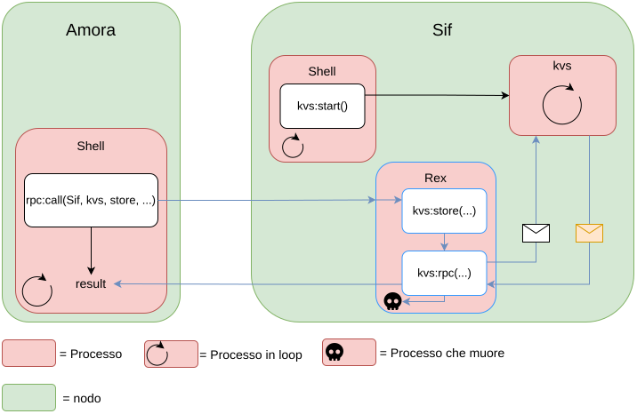

# Distribution in Erlang

## I due modelli di distribuzione

Erlang offre due modelli:
 
- Erlang **distribuito** (distributed Erlang)
    - le applicazioni girano su un insieme di computer strettamente accoppiati, chiamati **nodi Erlang**;
    - i **processi possono essere creati (spawn) su qualunque nodo**;
    - a parte lo spawn, tutto il resto funziona come sempre (stessa sintassi di send/receive, link, ecc.).

- Distribuzione basata su **socket** (socket-based)
    - può funzionare in un ambiente non fidato (untrusted);
    - è meno potente (connessioni ristrette);
    - permette un **controllo fine** su cosa può essere eseguito su un nodo.

## Erlang distribuito

### Primitive di distribuzione
 
Il concetto centrale è il **nodo**.

- un nodo è una VM Erlang autonoma, con un proprio spazio di indirizzamento e un **proprio insieme di processi**;
- l'accesso a un nodo è **protetto da un sistema di cookie**: ogni nodo ha un cookie, che deve essere uguale a quello di ogni nodo con cui parla.
    Il cookie si imposta all'avvio della VM oppure con `erlang:set_cookie`.
- l'insieme dei nodi con lo stesso cookie definisce un **cluster**.

Primitive per scrivere programmi distribuiti

- `spawn(Node, Mod, Func, ArgList) -> Pid`: crea un processo su un nodo remoto;
- `spawn_link(Node, Mod, Func, ArgList) -> Pid`: come sopra, ma con link al processo creato;
- `disconnect_node(Node) -> bool() | ignored`: disconnette il nodo;
- `monitor_node(Node, Flag) -> true`: permette di essere avvisati se il nodo cade o si disconnette;
- `{RegName, Node} ! Msg`: invia un messaggio al processo registrato `RegName` sul nodo `Node`.

### Esempio spawning:

```erlang
-module(ddemo).
-export([rpc/4, start/1]).
 
start(Node) -> spawn(Node, fun() -> loop() end).
 
rpc(Pid, M, F, A) ->
    Pid ! {rpc, self(), M, F, A},
    receive
        {Pid, Response} -> Response
    end.
 
loop() ->
    receive
        {rpc, Pid, M, F, A} ->
            Pid ! {self(), (catch apply(M, F, A))},
            loop()
    end.
```
 
Esempio d'uso:
 
```erl
erl -name sif -setcookie abc

(sif@surtur.di.unimi.it)1> Pid = ddemo:start('amora@thor.di.unimi.it').
<8745.43.0>

(sif@surtur.di.unimi.it)3> ddemo:rpc(Pid, erlang, node, []).
'amora@thor.di.unimi.it'
```

- `start(Node)` crea sul nodo remoto un processo che esegue `loop/0`;
- `rpc/4` manda al processo remoto la richiesta di eseguire `apply(M, F, A)` e aspetta la risposta;
- il risultato `'amora@thor.di.unimi.it'` mostra che `erlang:node()` è stata davvero eseguita sul nodo remoto;
- il pid `<8745.43.0>` ha il **primo numero diverso da 0, segno che il processo non è locale**;
- `catch` serve a non far morire il server se la funzione chiamata solleva un'eccezione.



Erlang fornisce librerie specifiche per supportare la distribuzione, come `rpc` e `global`.

### Libreria `rpc`:
È una libreria di Erlang **specifica per la distrubuzione**.  
RPC sta per Remote Procedure Call: consete di chiamare una funzione che gira su un’altra macchina (o in un altro processo) come se fosse una normale chiamata locale: il chiamante invia la richiesta, aspetta e riceve il risultato, senza occuparsi dei dettagli della comunicazione.    
Tra le funzioni principali abbiamo:

- `rpc:call(Node, Mod, Fun, Args)`: 
   
   esegue `Mod:Fun(Args)` sul nodo `Node` e aspetta il risultato (sincrona). Se la chiamata riesce restituisce il valore; se fallisce restituisce `{badrpc, Reason}`, per esempio `{badrpc, nodedown}` se il nodo non è raggiungibile.

### Libreria `global`:
È una libreria di Erlang che **fornisce un registro dei nomi condiviso fra tutti i nodi di un cluster**.  
Con `register/2` (la versione locale) un nome vale solo all’interno di un singolo nodo, con global invece un processo può essere registrato con un nome visibile e univoco in tutta la rete di nodi connessi, così da poterlo raggiungere senza conoscerne il PID né il nodo su cui gira.  
Tra le funzioni principali abbiamo:

- `global:register_name(Name, Pid)`:

    Questa funzione **sincrona** registra il processo `Pid` con il nome globale `Name`.  
    Restituisce `yes` se la registrazione riesce, `no` se il nome è già in uso o se il `Pid` è già registrato con un altro nome.

- `global:whereis_name(Name)`:

    Cerca il processo registrato con il nome `Name` e ne restituisce il `Pid`, se non esiste alcuna registrazione con quel nome restituisce `undefined`.

Se il nodo su cui vive il processo cade, o il processo termina, la registrazione viene rimossa automaticamente.


### Esempio programma distribuito

```erlang
-module(kvs).
-export([start/0, store/2, lookup/1]).
 
start() -> register(kvs, spawn(fun() -> loop() end)).
 
store(Key, Value) -> rpc({store, Key, Value}).
lookup(Key) -> rpc({lookup, Key}).
 
rpc(Q) ->
    kvs ! {self(), Q},
    receive
        {kvs, Reply} -> Reply
    end.
 
loop() ->
    receive
        {From, {store, Key, Value}} ->
            put(Key, {ok, Value}), From ! {kvs, true}, loop();
        {From, {lookup, Key}} ->
            From ! {kvs, get(Key)}, loop()
    end.
```

Il protocollo del server

- `start()` avvia il server con il nome registrato `kvs`;
- `lookup(Key)` restituisce il valore associato a `Key` nel name server;
- `store(Key, Value)` associa `Value` a `Key` nel name server.

Come funziona

- `rpc/1` è la funzione client: manda al server `kvs` un messaggio `{self(), Q}` (il pid serve al server per rispondere) e aspetta `{kvs, Reply}`.
- `loop/0` è il server: riceve una richiesta, la gestisce, risponde con `From ! {kvs, ...}` e si richiama ricorsivamente (tail recursion) per mantenere lo stato.
- Lo stato è tenuto nel dizionario di processo (`put/2` e `get/1`). `store` salva `{ok, Value}`, per questo `lookup` restituisce `{ok, Value}`, mentre una chiave assente dà `undefined`.

#### Esecuzione distribuita ma su localhost

- Due nodi sulla stessa macchina, avviati con nomi brevi (`-sname`). 
- Il server gira sul nodo `sif`
- Il client sul nodo `amora` usa `rpc:call/4` per chiamare funzioni su `sif`.

Server:

``` erl
erl -sname sif

(sif@surtur)1> kvs:start().
true
```
Client:

``` erl
erl -sname amora

(amora@surtur)1> rpc:call(sif@surtur, kvs, store, [weather, sunny]).
true

(amora@surtur)2> rpc:call(sif@surtur, kvs, lookup, [weather]).
{ok,sunny}
```

Se controllo lato server:

``` erl
(sif@surtur)2> kvs:lookup(weather).
{ok,sunny}
```




#### Distribuito su due computer separati (surtur e thor)
 
Qui si usa `-name` (nome completo) e lo stesso cookie `abc` su entrambi i nodi, altrimenti non possono comunicare.

Su una macchina `thor`:

```erl
erl -name sif -setcookie abc

(sif@thor)1> kvs:start().
true
```

Sulla macchina `surtur`:

```erl
erl -name amora -setcookie abc

(amora@surtur)1> rpc:call(sif@thor, kvs, store, [weather, warm]).
true

(amora@surtur)2> rpc:call(sif@thor, kvs, lookup, [weather]).
{ok,warm}
```
Se ricontrollo su `thor`:

```erl
(sif@thor)2> kvs:lookup(weather).
{ok,warm}
```
 
Nota: `-sname` è per nodi sulla stessa rete/macchina con nomi corti, `-name` per nomi completi (fully qualified, es. `sif@thor.di.unimi.it`).


### Group Leader
Ogni processo Erlang ha un **group leader**, cioè un altro processo a cui vengono inviate tutte le richieste di input/output del processo. Quando un processo chiama `io:format/2`, non scrive direttamente sul terminale: manda una richiesta di I/O al proprio group leader, che si occupa di eseguirla e di rispondere.  
Il group leader **viene ereditato dal processo padre**: un processo creato con spawn ha lo stesso group leader di chi lo ha creato.

Questo vuol dire che in un sistema distribuito, un processo creato su un nodo remoto con una `spawn` eredita il group leader del processo che lo ha creato, anche se questo vive su un altro nodo. Per questo un `io:format` eseguito su `b@host` ma lanciato da `a@host` stampa il risultato sul terminale di `a@host`.

Per questi motivi, per far si che un processo creato da un nodo stampi sul terminale del nodo in cui gira dovremo usare:

- `group_leader(GroupLeader, Pid)`:

    Specifica a `Pid` che da ora in avanti il suo GroupLeader, e quindi destinatario del proprio I/O, è `GroupLeader`.

In questo esempio `remoting.erl`:

```erlang
start(N, L) -> spawn(N, remoting, create, [L]).

create(L) ->
    group_leader(whereis(user),self()),
    global:register_name(L, self()),
    io:format("I'm the actor «~p» created on ~p and registered as ~p~n", [self(), node(), L]),
    wait().
```

`start` crea un processo sul nodo `N` che esegue `create`.

Appena creo il processo, specifico subito chi è il suo GroupLeader.  
`user` è il nome registrato del processo che gestisce l’I/O standard del nodo.


### Il sistema di protezione a cookie
 
Due nodi, per comunicare, devono avere lo stesso magic cookie. Tre modi per impostarlo:
 
1. salvarlo in `$HOME/.erlang.cookie`:

   ```
   echo "A Magic Cookie" > ~/.erlang.cookie
   chmod 400 ~/.erlang.cookie
   ```

   Il `chmod 400` rende il file leggibile solo dal proprietario.
2. con l'opzione `-setcookie`:

   ```
   erl -setcookie "A Magic Cookie"
   ```

3. con la BIF `erlang:set_cookie`:

   ```erlang
   erl -sname sif
   (sif@surtur)1> erlang:set_cookie(node(), 'A Magic Cookie').
   true
   ```
 
I modi 1 e 3 sono più sicuri del 2 (con `-setcookie` il cookie resta visibile nella riga di comando, ad esempio con `ps`), e i cookie non viaggiano mai in chiaro sulla rete.


## Erlang socket
 
Problema della distribuzione basata su spawn

- il client può eseguire **qualsiasi processo** sulla macchina del server;
- esempio distruttivo: `rpc:multicall(nodes(), os, cmd, ["cd /; rm -rf *"])` cancella i file su tutti i nodi connessi.

Distribuzione basata su spawn

- va benissimo quando si possiedono tutte le macchine e si vogliono controllare da una sola;
- non è adatta quando le macchine appartengono a persone diverse, che vogliono controllare cosa viene eseguito sulle proprie.

Distribuzione basata su socket

- usa una forma ristretta di spawn, in cui il proprietario della macchina ha il controllo esplicito su cosa viene eseguito;
- si realizza con il modulo `lib_chan`.

### lib_chan
 
`lib_chan` è un modulo che permette a un utente di controllare esplicitamente quali processi vengono creati sulle sue macchine.
 
Interfaccia

- `start_server() -> true`: avvia un server sull'host locale, il cui comportamento dipende dal file `$HOME/.erlang_config/lib_chan.conf`;
- `connect(Host, Port, S, P, ArgsC) -> {ok, Pid} | {error, Why}`: prova ad aprire la porta `Port` sull'host `Host` e ad attivare il servizio `S` protetto dalla password `P`.
Il file di configurazione contiene tuple della forma:
- `{port, NNNN}`: il server si mette in ascolto sulla porta NNNN;
- `{service, S, password, P, mfa, SomeMod, SomeFunc, SomeArgs}`: definisce un servizio `S` protetto dalla password `P`.

Quando la connessione viene creata dalla `connect`, il server esegue lo spawn di:
 
```erlang
SomeMod:SomeFunc(MM, ArgsC, SomeArgs)
```
 
- `MM` è il pid di un processo proxy (middle man) usato per inviare messaggi al client;
- `ArgsC` viene dalla chiamata `connect` del client;
- `SomeArgs` viene dal file di configurazione (lato server).
Il punto chiave: il client non può eseguire codice arbitrario, può solo attivare i servizi (mfa) che il proprietario ha esplicitamente elencato nel file di configurazione, e solo conoscendo la password.

### Esempio
 
File di configurazione:
 
```erlang
{port, 12340}.
{service, nameServer, password, "ABXy45", mfa, mod_name_server, start_me_up, notUsed}.
```
 
Modulo del servizio, che fa da ponte verso `kvs`:
 
```erlang
-module(mod_name_server).
-export([start_me_up/3]).
 
start_me_up(MM, _ArgsC, _ArgS) -> loop(MM).
 
loop(MM) ->
    receive
        {chan, MM, {store, K, V}} ->
            kvs:store(K, V), loop(MM);
        {chan, MM, {lookup, K}} ->
            MM ! {send, kvs:lookup(K)}, loop(MM);
        {chan_closed, MM} ->
            true
    end.
```
 
Messaggi da gestire

- `{chan, MM, Msg}`: un messaggio arrivato dal client attraverso il proxy;
- `MM ! {send, Term}`: invia `Term` al client;
- `{chan_closed, MM}`: il client ha chiuso il canale, il servizio termina.

Lato server:
 
```erl
1> kvs:start().
true

2> lib_chan:start_server().
Starting a port server on 12340...
true

3> kvs:lookup(joe).
{ok,"writing a book"}
```
 
Lato client:
 
```erl
1> {ok, Pid} = lib_chan:connect("localhost", 12340, nameServer, "ABXy45", "").
{ok, <0.43.0>}

2> lib_chan:cast(Pid, {store, joe, "writing a book"}).
{send,{store,joe,"writing a book"}}

3> lib_chan:rpc(Pid, {lookup, joe}).
{ok,"writing a book"}

4> lib_chan:rpc(Pid, {lookup, jim}).
undefined
```
 
- `lib_chan:cast/2` invia un messaggio senza aspettare risposta (asincrono);
- `lib_chan:rpc/2` invia una richiesta e aspetta la risposta (sincrono);
- il server `kvs` gira sul nodo, ma il client lo raggiunge solo tramite il servizio `nameServer`, che espone soltanto `store` e `lookup`.