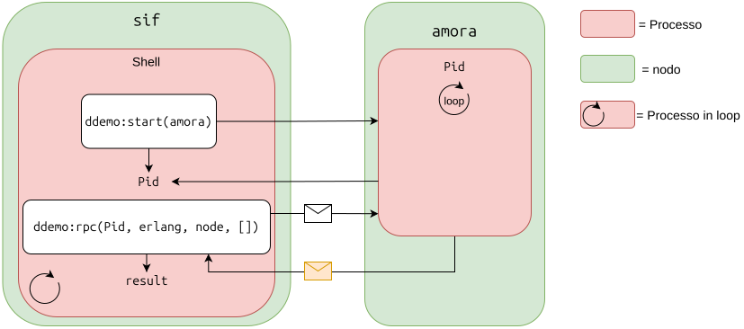

# Erlang distribuito

Consideriamo come esempio un semplice name server `kvs`:

```erlang
-module(kvs).
-export([start/0, store/2, lookup/1]).
 
start() -> register(kvs, spawn(fun() -> loop() end)).
 
store(Key, Value) -> rpc({store, Key, Value}).
lookup(Key) -> rpc({lookup, Key}).
 
rpc(Q) ->
    kvs ! {self(), Q},
    receive
        {kvs, Reply} -> Reply
    end.
 
loop() ->
    receive
        {From, {store, Key, Value}} ->
            put(Key, {ok, Value}), From ! {kvs, true}, loop();
        {From, {lookup, Key}} ->
            From ! {kvs, get(Key)}, loop()
    end.
```

Come funziona

- `start()` avvia il server con il nome registrato `kvs`;
- `lookup(Key)` restituisce il valore associato a `Key` nel name server;
- `store(Key, Value)` associa `Value` a `Key` nel name server.
- `rpc/1` è la funzione client: manda al server `kvs` un messaggio `{self(), Q}` (il pid serve al server per rispondere) e aspetta `{kvs, Reply}`.
- `loop/0` è il server: riceve una richiesta, la gestisce, risponde con `From ! {kvs, ...}` e si richiama ricorsivamente (tail recursion) per mantenere lo stato.
- Lo stato è tenuto nel dizionario di processo (`put/2` e `get/1`). `store` salva `{ok, Value}`, per questo `lookup` restituisce `{ok, Value}`, mentre una chiave assente dà `undefined`.


## Nodi separati sullo stesso computer


### Creazione nodi

Creiamo 2 nodi Erlang sullo stesso computer, possiamo farlo aprendo 2 terminali e inizializzando il sistema Erlang specificando il nome del nodo usando `erl -sname <name>`:

```bash
$ erl -sname gandalf
```

Questo comando inizializza un nodo Erlang con il nome di `gandalf` sull'host locale. Il nome del nodo sarà nella forma `Name@Host`.  
`-sname` usa nomi corti, e un nodo creato con `-sname` può comunicare solo con nodi creati con `-sname`.

### Esempio
In questo modo ora possiamo mettere il server `kvs` su un nodo e con l'altro invieremo le richieste.

Server:

``` erl
erl -sname sif

(sif@surtur)1> kvs:start().
true
```

Client:

``` erl
erl -sname amora

(amora@surtur)1> rpc:call(sif@surtur, kvs, store, [weather, sunny]).
true

(amora@surtur)2> rpc:call(sif@surtur, kvs, lookup, [weather]).
{ok,sunny}
```

Se controllo lato server:

``` erl
(sif@surtur)2> kvs:lookup(weather).
{ok,sunny}
```

## Nodi su computer diversi

### Creazione nodi
Per creare un nodo su computer che sono in reti diverse usiamo il comando: `erl -name <name>`

```bash
$ erl -name bilbo
```

`-name` usa nomi completi (fully qualified), inoltre un nodo creato con `-name` può comunicare solo con altri nomi creati con `-name`.


### Cookie
Due nodi su reti diverse, per comunicare, devono essere nello stesso **cluster** e devono avere lo stesso magic cookie. Tre modi per impostarlo:
 
1. salvarlo in `$HOME/.erlang.cookie`:

   ```
   echo "A Magic Cookie" > ~/.erlang.cookie
   chmod 400 ~/.erlang.cookie
   ```

   Il `chmod 400` rende il file leggibile solo dal proprietario.
2. con l'opzione `-setcookie`:

   ```
   erl -setcookie "A Magic Cookie"
   ```

3. con la BIF `erlang:set_cookie`:

   ```erlang
   erl -sname sif
   (sif@surtur)1> erlang:set_cookie(node(), 'A Magic Cookie').
   true
   ```
 
I modi 1 e 3 sono più sicuri del 2 (con `-setcookie` il cookie resta visibile nella riga di comando, ad esempio con `ps`), e i cookie non viaggiano mai in chiaro sulla rete.

### Esempio
Ora possiamo mettere il server `kvs` su un nodo e con l'altro invieremo le richieste.

Su una macchina `thor`:

```erl
erl -name sif -setcookie abc

(sif@thor)1> kvs:start().
true
```

Sulla macchina `surtur`:

```erl
erl -name amora -setcookie abc

(amora@surtur)1> rpc:call(sif@thor, kvs, store, [weather, warm]).
true

(amora@surtur)2> rpc:call(sif@thor, kvs, lookup, [weather]).
{ok,warm}
```
Se ricontrollo su `thor`:

```erl
(sif@thor)2> kvs:lookup(weather).
{ok,warm}
```

## Comunicazione tra nodi e `rpc`

> Un nodo è una VM Erlang autonoma, con un proprio spazio di indirizzamento e un **proprio insieme di processi**.

Come abbiamo visto negli esempi, il punto centrale di un programma distribuito consiste nella comunicazione tra i nodi: fondamentalmente che si trattino di nodi sullo stesso host o su computer diversi, i modi di comunicare tra di essi sono quelli che vedremo in questa sezione.

### Scambio di messaggi
Per inviare il messaggio a un processo su un dato nodo, a patto di conoscere il suo `Pid`, possiamo continuare a usare:

```erlang
Pid ! Msg
```

Altrimenti se sappiamo con quale nome tale processo è **registrato localmente** sul nodo possiamo usare:

```erlang
{RegName, Node} ! Msg
```

Con questa sintassi inviamo un messaggio al processo registrato `RegName` sul nodo `Node`.

### Libreria `rpc`
È una libreria di Erlang **specifica per la distribuzione**.  
RPC sta per Remote Procedure Call: consente di chiamare una funzione che gira su un’altra macchina (o in un altro processo) come se fosse una normale chiamata locale: il chiamante invia la richiesta, aspetta e riceve il risultato, senza occuparsi dei dettagli della comunicazione.    
Tra le funzioni principali abbiamo:

- `rpc:call(Node, Mod, Fun, Args)`: 
   
   esegue `Mod:Fun(Args)` sul nodo `Node` e aspetta il risultato (sincrona). Se la chiamata riesce restituisce il valore; se fallisce restituisce `{badrpc, Reason}`, per esempio `{badrpc, nodedown}` se il nodo non è raggiungibile.

   

## Cluster
> Un cluster è l’insieme dei **nodi connessi tra loro**; per connettersi devono avere lo stesso cookie.

Due nodi con lo stesso cookie ma mai in contatto non sono ancora nello stesso cluster, affinché lo siano devono prima connettersi tramite:

- invio di messaggio;
- `rpc:call`;
- `spawn` remoto.

### Primitive per lavorare con i nodi del cluster

- `spawn(Node, Mod, Func, ArgList) -> Pid`: crea un processo su un nodo remoto;
- `spawn_link(Node, Mod, Func, ArgList) -> Pid`: come sopra, ma con link al processo creato;
- `disconnect_node(Node) -> bool() | ignored`: disconnette il nodo;
- `monitor_node(Node, Flag) -> true`: permette di essere avvisati se il nodo cade o si disconnette.

### Primitive per orientarsi in un cluster

- `node()`:

    Restituisce il nome del nodo locale.

- `node(Arg)`:

    Restituisce il nodo dove `Arg` è situato. `Arg` può essere un Pid, un riferimento o una porta.

- `nodes()`:

    Restituisce una lista contentente gli altri nodi del network con il quale siamo connessi.

- `is_alive()`:

    Restituisce `true` se il nodo locale è vivo e può essere parte di un sistema distribuito, `false` altrimenti.

### Libreria `global`
È una libreria di Erlang che **fornisce un registro dei nomi condiviso fra tutti i nodi di un cluster**.  
Con `register/2` (la versione locale) un nome vale solo all’interno di un singolo nodo, con global invece un processo può essere registrato con un nome visibile e univoco in tutta la rete di nodi connessi, così da poterlo raggiungere senza conoscerne il PID né il nodo su cui gira.  
Tra le funzioni principali abbiamo:

- `global:register_name(Name, Pid)`:

    Questa funzione **sincrona** registra il processo `Pid` con il nome globale `Name`.  
    Restituisce `yes` se la registrazione riesce, `no` se il nome è già in uso o se il `Pid` è già registrato con un altro nome.

- `global:whereis_name(Name)`:

    Cerca il processo registrato con il nome `Name` e ne restituisce il `Pid`, se non esiste alcuna registrazione con quel nome restituisce `undefined`.

Se il nodo su cui vive il processo cade, o il processo termina, la registrazione viene rimossa automaticamente.

### Esempio spawning in un cluster

```erlang
-module(ddemo).
-export([rpc/4, start/1]).
 
start(Node) -> spawn(Node, fun() -> loop() end).
 
rpc(Pid, M, F, A) ->
    Pid ! {rpc, self(), M, F, A},
    receive
        {Pid, Response} -> Response
    end.
 
loop() ->
    receive
        {rpc, Pid, M, F, A} ->
            Pid ! {self(), (catch apply(M, F, A))},
            loop()
    end.
```
 
Esempio d'uso:
 
```erl
erl -name sif -setcookie abc

(sif@surtur.di.unimi.it)1> Pid = ddemo:start('amora@thor.di.unimi.it').
<8745.43.0>

(sif@surtur.di.unimi.it)3> ddemo:rpc(Pid, erlang, node, []).
'amora@thor.di.unimi.it'
```

- `start(Node)` crea sul nodo remoto un processo che esegue `loop/0`;
- `rpc/4` manda al processo remoto la richiesta di eseguire `apply(M, F, A)` e aspetta la risposta;
- il risultato `'amora@thor.di.unimi.it'` mostra che `erlang:node()` è stata davvero eseguita sul nodo remoto;
- il pid `<8745.43.0>` ha il **primo numero diverso da 0, segno che il processo non è locale**;
- `catch` serve a non far morire il server se la funzione chiamata solleva un'eccezione.



### Group Leader
Il group leader è un concetto generale di Erlang, ma diventa rilevante nel cluster perché lo spawn remoto lo eredita dal nodo che crea il processo.  
Ogni processo Erlang ha un **group leader**, cioè un altro processo a cui vengono inviate tutte le richieste di input/output del processo. Quando un processo chiama `io:format/2`, non scrive direttamente sul terminale: manda una richiesta di I/O al proprio group leader, che si occupa di eseguirla e di rispondere.  
Il group leader **viene ereditato dal processo padre**: un processo creato con spawn ha lo stesso group leader di chi lo ha creato.

Questo vuol dire che in un sistema distribuito, un processo creato su un nodo remoto con una `spawn` eredita il group leader del processo che lo ha creato, anche se questo vive su un altro nodo. Per questo un `io:format` eseguito su `b@host` ma lanciato da `a@host` stampa il risultato sul terminale di `a@host`.

Per questi motivi, per far sì che un processo creato da un nodo stampi sul terminale del nodo in cui gira dovremo usare:

- `group_leader(GroupLeader, Pid)`:

    Specifica a `Pid` che da ora in avanti il suo group leader, e quindi destinatario del proprio I/O, è `GroupLeader`.

In questo esempio `remoting.erl`:

```erlang
start(N, L) -> spawn(N, remoting, create, [L]).

create(L) ->
    group_leader(whereis(user), self()),
    global:register_name(L, self()),
    io:format("I'm the actor «~p» created on ~p and registered as ~p~n", [self(), node(), L]),
    wait().
```

`start` crea un processo sul nodo `N` che esegue `create`.

Appena creo il processo, specifico subito chi è il suo group leader.  
`user` è il nome registrato del processo che gestisce l’I/O standard del nodo.