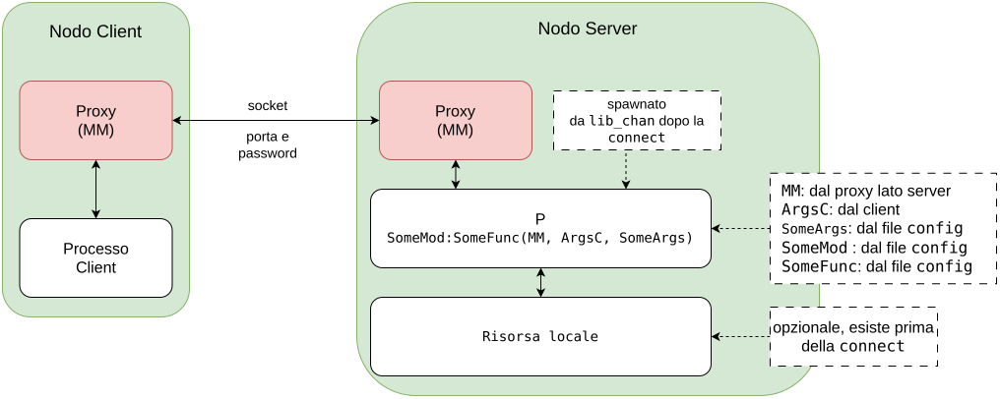
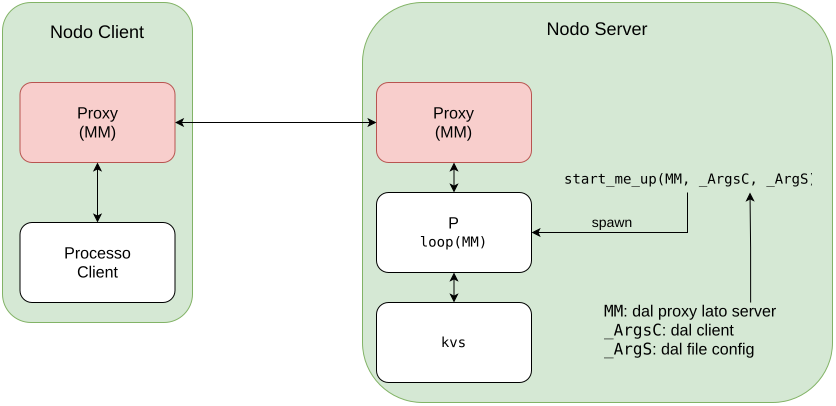

# Erlang socket
 
Problema della distribuzione basata su `spawn` remota:

- il client può eseguire **qualsiasi processo** sulla macchina del server;
- esempio distruttivo: `rpc:multicall(nodes(), os, cmd, ["cd /; rm -rf *"])` cancella i file su tutti i nodi connessi.

Quindi la distribuzione basata su spawn remota:

- va benissimo quando si possiedono tutte le macchine e si vogliono controllare da una sola;
- va bene quando siamo nella stessa LAN.
- non è adatta quando le macchine appartengono a persone diverse, che vogliono controllare cosa viene eseguito sulle proprie.

Mentre la distribuzione basata su socket

- usa una forma ristretta di spawn, in cui il proprietario della macchina ha il controllo esplicito su cosa viene eseguito;
- si realizza con il modulo `lib_chan`.

## lib_chan
 
`lib_chan` è un modulo che permette a un utente di **controllare esplicitamente quali processi vengono creati sulle sue macchine**.
 
Interfaccia:

- `start_server() -> true`: 

    avvia un server sull'host locale, il cui comportamento dipende dal file `$HOME/.erlang_config/lib_chan.conf`;

- `connect(Host, Port, S, P, ArgsC) -> {ok, Pid} | {error, Why}`: 

    prova ad aprire la porta `Port` sull'host `Host` e ad attivare il servizio `S` protetto dalla password `P`.

- `cast(Pid, Msg)`:

    invia un messaggio al servizio (`Pid` è quello restituito da `connect`) e non aspetta risposta (asincrono).  
    `cast` manderà come messaggio `{send, Msg}` al proprio proxy, il servizio riceverà il messaggio `{chan, MM, Msg}`.

- `rpc(Pid, Msg)`:

    invia una richiesta e aspetta la risposta (sincrono).  

    Il flusso di messaggi è lo stesso di `cast`: `rpc` manda `{send, Msg}` al proprio proxy e il servizio riceve `{chan, MM, Msg}`.  
    Il servizio risponde con `{send, Result}` al proprio proxy, e il client, che tramite `rpc` era rimasto in attesa, riceve `{chan, MM, Result}` dal suo proxy e restituisce solo `Result`.

Il file di configurazione contiene tuple della forma:

- `{port, NNNN}`: il server si mette in ascolto sulla porta NNNN;
- `{service, S, password, P, mfa, SomeMod, SomeFunc, SomeArgs}`: definisce un servizio `S` protetto dalla password `P`.

Quando la connessione viene creata dal client invocando `connect`, due processi proxy vengono spawnati: uno sul lato client e l'altro sul lato server.
Ora il server esegue lo spawn di un processo che esegue:
 
```erlang
SomeMod:SomeFunc(MM, ArgsC, SomeArgs)
```


 
Dove:

- `MM` è il pid di un processo proxy (middle man) usato per inviare messaggi al client;
- `ArgsC` viene dalla chiamata `connect` del client;
- `SomeArgs` viene dal file di configurazione (lato server).

Il punto chiave: il client non può eseguire codice arbitrario, può solo attivare i servizi che il proprietario ha esplicitamente elencato nel file di configurazione, e solo conoscendo la password.

## Esempio
 
File di configurazione:
 
```erlang
{port, 12340}.
{service, nameServer, password, "ABXy45", mfa, mod_name_server, start_me_up, notUsed}.
```

Questo significa che stiamo offrendo un servizio, protetto dalla password `ABXy45` chiamato `nameServer` sulla porta `12340` del nostro computer.
 
Modulo del servizio, che fa da ponte verso `kvs`:
 
```erlang
-module(mod_name_server).
-export([start_me_up/3]).
 
start_me_up(MM, _ArgsC, _ArgS) -> loop(MM).
 
loop(MM) ->
    receive
        {chan, MM, {store, K, V}} ->
            kvs:store(K, V), loop(MM);
        {chan, MM, {lookup, K}} ->
            MM ! {send, kvs:lookup(K)}, loop(MM);
        {chan_closed, MM} ->
            true
    end.
```
 
Messaggi da gestire

- `{chan, MM, Msg}`: un messaggio arrivato dal client attraverso il proxy;
- `MM ! {send, Term}`: invia `Term` al client;
- `{chan_closed, MM}`: il client ha chiuso il canale, il servizio termina.

Lato server:
 
```erl
1> kvs:start().
true

2> lib_chan:start_server().
Starting a port server on 12340...
true

3> kvs:lookup(joe).
{ok,"writing a book"}
```
 
Lato client:
 
```erl
1> {ok, Pid} = lib_chan:connect("localhost", 12340, nameServer, "ABXy45", "").
{ok, <0.43.0>}

2> lib_chan:cast(Pid, {store, joe, "writing a book"}).
{send,{store,joe,"writing a book"}}

3> lib_chan:rpc(Pid, {lookup, joe}).
{ok,"writing a book"}

4> lib_chan:rpc(Pid, {lookup, jim}).
undefined
```



- il server `kvs` gira sul nodo, ma il client lo raggiunge solo tramite il servizio `nameServer`, che espone soltanto `store` e `lookup`.