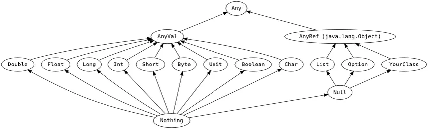

# Type Hierarchy

La gerarchia dei tipi in scala è composta in questo modo
- Any, la radice della gerarchia
    - AnyVal, la radice di tutti i tipi primitivi
    - AnyRef, la radice di tutte le *reference classes* (incluse `java.*` e `scala.*`). E' l'equivalente della classe `Object`

Due tipi di valori "vuoti"
- `Null`, per tutti i reference types. Ha una sola istanza `null`. Corrisponde al concetto di null del runtime
- `Nothing`, è il sottotipo di tutti, non ha istanze. Usato per definire i tipi in modo sicuro es. `List[Nothing]`
